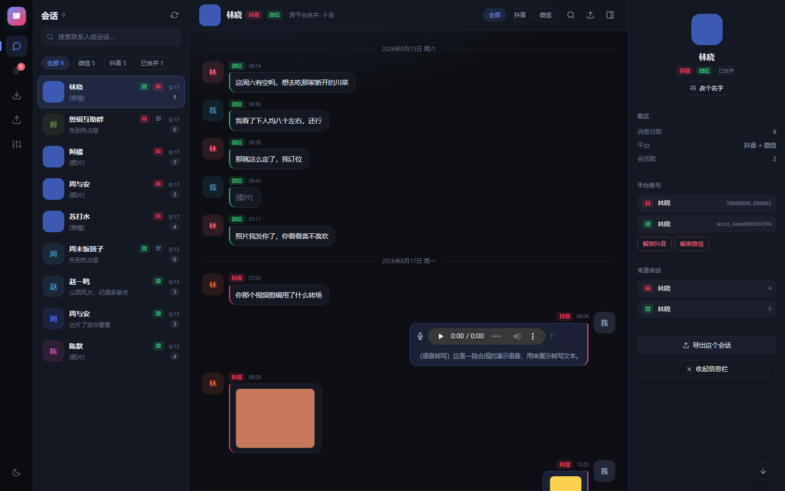
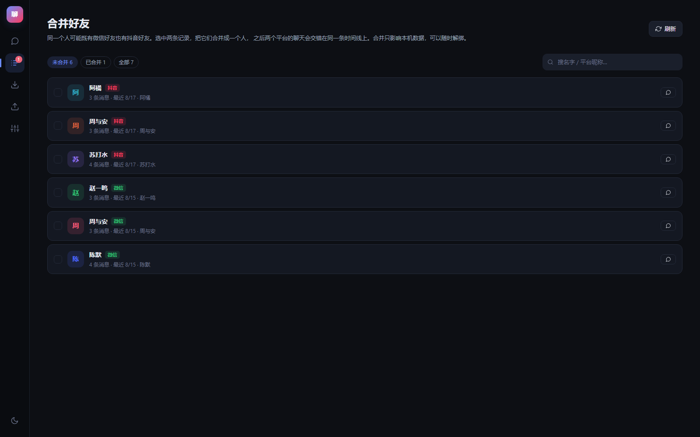
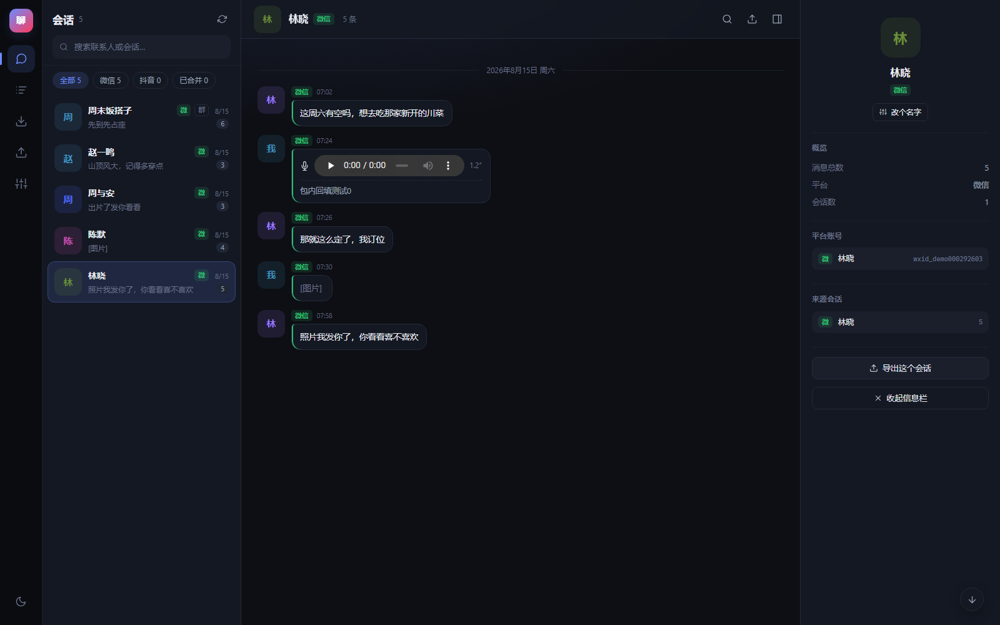

# 聊天信息工作台

**把微信和抖音的聊天记录合并成一条可以浏览、搜索、导出的时间线。**

同一个人可能既是你的微信好友，也是你的抖音好友。这个工具把两边的记录读进同一个本地数据库，
让你手动把「同一个人」的两个账号合并，然后按时间交错地看完整对话。

<br>

<picture>
  <source media="(prefers-color-scheme: dark)" srcset="docs/screenshots/merged-dark.png">
  <source media="(prefers-color-scheme: light)" srcset="docs/screenshots/merged-light.png">
  
</picture>

<sub>同一个人的微信（8/15）和抖音（8/17）消息按时间交错；右侧能看到两个平台账号和各自的来源会话。</sub>

<br>

<picture>
  <source media="(prefers-color-scheme: dark)" srcset="docs/screenshots/merge-friends.png">
  <source media="(prefers-color-scheme: light)" srcset="docs/screenshots/merge-friends.png">
  
</picture>

<sub>「合并好友」：选中两条记录即可合并成一个人，可随时解绑。</sub>

<br>

- **纯本地**：所有数据都在你自己的机器上，不上传、不联网（只有你自己触发的解密/采集会访问对应平台）
- **开源**：AGPL-3.0，仓库里不含任何真实聊天数据、密钥或账号信息
- **可离线**：便携版解压即用，内置 Python 运行时

---

## 目录

- [功能](#功能)
- [快速开始](#快速开始)
- [使用流程](#使用流程)
- [数据与隐私](#数据与隐私)
- [工作原理](#工作原理)
- [目录结构](#目录结构)
- [开发](#开发)
- [已知限制](#已知限制)
- [许可证与致谢](#许可证与致谢)

---

## 功能

**跨平台合并**
- 手动把微信好友和抖音好友合并成「一个人」，两个平台的对话交错在同一条时间线上
- 每条消息都带平台角标，可以一键只看某个平台
- 合并后可随时解绑，解绑只影响关联，不删任何消息

**浏览**
- 会话列表按最近活跃排序，支持按平台筛选、按名字搜索
- 日期分隔、群聊显示发言人、引用回复、图片放大
- **语音**：微信的 SILK 音频按需转成 WAV 播放，气泡里同时显示转写文本
- **语音识别**：腾讯云一句话识别（应用内填密钥）或本地 faster-whisper（免费离线），
  支持批量、失败重试、导入后自动识别
- **搜索**：全文检索（FTS5 trigram，中文子串可命中）+ 平台/类型/时间/发送者筛选、
  分页、按会话分组；语音转写也参与搜索
- **媒体库**：会话内查看图片/表情/视频/文件，可一键把缺失的微信媒体批量解密缓存
- **多账号**：按微信账号筛选会话；群成员列表可点击跳到和 TA 的私聊
- **增量导入**：只读上次之后的新消息（水位线回退一天防漏），可随时切回全量重扫
- **跟随系统**：外观可跟随系统深/浅色自动切换
- **更新检查**：填 GitHub Release API 或自定义清单地址，检查新版本并跳转下载
- **工程**：pytest 155 个用例 + Playwright E2E 冒烟 + GitHub Actions CI；任务日志自动脱敏
- **外观**：内置 4 套 + StyleKit 151 套风格，圆角 / 边框 / 阴影 / 配色整站切换
- **微信图片/表情/视频**：按需解密/定位，能取到就显示，取不到给明确原因
- 会话内搜索并跳转到那一条
- 四套主题（深色 / 浅色 / 暖棕 / 紫夜）

**导入**
- 微信：内置 SIWX 解密组件，从本机微信数据库读消息（需要微信已登录）；
  语音原始文件（SILK）随消息一起落地；图片/视频在显示时按需解密
- 抖音：内置采集组件直接调用抖音 IM 接口，浏览器自动化已随包内置
  （优先驱动系统自带的 Edge，不额外下载 Chromium）；也可以直接导入已有的 `chat.db`
- **抖音采集范围**：全部会话 / 只采集勾选的会话 / 排除勾选的会话，支持搜索、全选、增量开关
- **抖音采集增强**：进度按「第 N/M 个会话」显示、失败会话一键重试、可选下载媒体、
  群成员显示昵称与抖音号
- **抖音语音兜底**：采集时原生识别失败的语音，导入后用腾讯云/本地引擎补转写（可在设置关掉）
- 重复导入是幂等的，不会产生重复消息

**导出**
- ChatLab v0.0.2 格式（JSON / JSONL），可以直接喂给 ChatLab 等分析工具
- Markdown，方便归档和直接阅读
- 合并会话可以分别导出单平台，也可以合成一份

**为什么第一版没有 AI**
这一版专注把「数据打通 + 看得到」做扎实。事实抽取、人物画像这类能力留到后续版本，
避免一上来就把简单问题复杂化。

---

## 快速开始

### 方式一：便携版（推荐给普通用户）

1. 下载并解压 `聊天信息工作台.zip`
2. 双击 **`启动.cmd`**
3. 应用窗口打开后，左侧进入「导入数据」

如果窗口没出现，双击 `启动-调试.cmd`，控制台里会显示具体错误，
详细信息也会写到 `data/logs/launcher.log`。

> 便携版基于 Windows 10/11 + WebView2（系统自带）。
> 若系统缺失 WebView2，程序会退化成用默认浏览器打开。

### 方式二：从源码运行

```bash
git clone <本仓库地址>
cd 聊天信息工作台

# Python 3.11（pilk / SIWX 不支持 3.13+）
py -3.11 -m venv .venv
.venv\Scripts\activate
pip install -r requirements.txt

# 前端
cd web
npm install
npm run build
cd ..

# 启动（原生窗口）
python launcher.py

# 或者只起后端，用浏览器访问 http://127.0.0.1:8765
python -m uvicorn app.main:app --port 8765
```

想先看看界面长什么样，可以先造一份**完全合成**的演示数据：

```bash
python scripts/make_demo_data.py --import
```

---

## 使用流程

### 1. 导入微信

微信的数据是 SQLCipher 加密的，需要先从进程内存里取密钥再解密。

- 打开微信并保持登录
- 「导入数据」→ 微信卡片 → **解密并导入**

解密产物会落在 `data/wechat/decrypted/`，之后的浏览只读这份明文库。
如果你的环境已经用 SIWX 解好密了，可以直接把账号目录放进去，点「只导入已解密数据」。

> 微信每次升级都可能改变数据库结构，解密组件跟不上时需要等上游 SIWX 更新。

### 2. 导入抖音

两种方式：

- **直接导入已有数据库**：选择 `chat.db`（上游引擎或本工具产出的都行），媒体文件会被复制进 `data/media/`
- **在线采集**：「采集并导入」会弹出浏览器窗口，扫码登录即可。
  浏览器优先用系统 Edge；机器上没有 Edge 时才需要
  `playwright install chromium`（或设置 `CHATWORK_BROWSER_CHANNEL=chrome` 用 Chrome）

### 3. 合并同一个人的两个账号

「合并好友」→ 在列表里选中微信那条和抖音那条 → 「合并这两个」。

建议先看一眼两边的昵称、备注和聊天内容，确认是同一个人再合并。
合并只建立关联，不会改动任何原始数据。

### 4. 语音

微信语音导入时**只保存原始 SILK**（省空间），只有真的点播放才转成 16 kHz WAV
并缓存到 `data/media/voice_cache/`，第一次约 20–60 ms，之后直接读缓存。



旧项目已经转写好的 `voice_api.jsonl` 可以在「导入数据 → 微信卡片」里回填，
它的 id 与我们的消息 id 格式一致，能 100% 对上；转写文本参与搜索。

### 5. 语音识别

「语音识别」页：选引擎（腾讯云 / 本地）→ 选范围（待转写 / 失败重试 / 全部重跑）→ 开始。
识别结果直接显示在语音气泡里并参与搜索；导入后自动识别可在设置里打开。

密钥在「设置 → 语音识别」里填，保存在 `data/secrets.json`（不进仓库）；
也可以用环境变量 `TENCENT_SECRET_ID` / `TENCENT_SECRET_KEY` 覆盖。

### 6. 外观

左侧「外观」页有 155 套配色（内置 4 + StyleKit 151），可以按分类筛选、搜索，
点一下立即生效。每套主题会同时改变背景、面板、边框、文字、强调色，以及
圆角、边框宽度和阴影；选择保存在本机，下次启动直接恢复（首屏做了防闪）。

数据由 `scripts/fetch_stylekit_themes.py` 从 StyleKit（MIT）归一化生成，
提交在 `app/data/stylekit_themes.json`，日常开发不需要联网。

### 7. 浏览与导出

回到「聊天」，合并后的会话会同时显示两个平台的消息；右侧信息栏能看到两个平台账号的来源。
「导出」可以选择 ChatLab JSONL / JSON / Markdown。

---

## 数据与隐私

这个项目的设计前提是：**你的聊天记录只属于你**。

- 所有数据都保存在应用目录的 `data/` 下，没有任何云端同步
- 后端只监听 `127.0.0.1`，局域网内其它设备访问不到
- 仓库里不含任何真实聊天数据、密钥、账号目录名或个人信息
- 演示数据由 `scripts/make_demo_data.py` 生成，人物与内容全是编的

`data/` 的布局：

```
data/
├─ unified.db          统一数据库（联系人 / 会话 / 消息 / 导入记录）
├─ settings.json       界面设置
├─ secrets.json        云端识别密钥（不进仓库）
├─ media/              图片、语音、视频
│  ├─ douyin/          抖音媒体（按上游的 images/emoji/voice/videos 分目录）
│  ├─ wechat/          微信语音原始 SILK（按账号/分片/会话哈希分目录）
│  └─ voice_cache/     SILK 按需转出来的 WAV 缓存（可随时删除）
├─ wechat/decrypted/   微信解密产物
├─ douyin/             抖音 chat.db 与浏览器登录态
├─ exports/            导出文件
└─ logs/               日志
```

**访问边界**：后端只监听 `127.0.0.1`，并且校验 Host 头（只接受本机名），
防止恶意网页通过 DNS rebinding 读取本地数据；导出下载和静态文件都有路径校验。

**备份**：直接复制整个 `data/` 目录。
**换机**：把应用目录和 `data/` 一起带过去即可。

---

## 工作原理

```
微信客户端 ──SIWX──▶ 明文 SQLCipher 库 ──导入器──┐
                                                  ├─▶ data/unified.db ──▶ FastAPI ──▶ Vue 界面
抖音客户端 ──采集/chat.db────────────────导入器──┘
```

统一数据模型的核心是三张表：

| 表 | 含义 |
|---|---|
| `contacts` | **一个人**（不是某个平台账号） |
| `identities` | 这个人在某个平台的账号（`platform + platform_uid`） |
| `conversations` | 平台原始会话，私聊通过 `contact_id` 挂到某个人身上 |

同一个 `contact` 下挂两个平台的 `conversations`，查询时把它们合并成一个
「thread」，按 `ts` 排序就是交错时间线。群聊没有 `contact`，单独作为一条会话。

**性能**（61.8 万条消息实测）：会话列表 3 ms，单会话跳转 1 ms，
导出 13.7 万条的会话 1.4 秒、内存占用 25 MB。做法是物化会话统计 + 流式导出，
细节见 [docs/ARCHITECTURE.md](docs/ARCHITECTURE.md)；接手维护请看
[docs/HANDOVER.md](docs/HANDOVER.md)（当前状态、常见坑、下一阶段路线图）。

---

## 目录结构

```
聊天信息工作台/
├─ app/                     后端
│  ├─ main.py               FastAPI 应用与静态托管
│  ├─ desktop.py            pywebview 桌面外壳
│  ├─ api.py                REST 接口
│  ├─ db.py                 统一库 schema 与读写
│  ├─ threads.py            跨平台聚合查询
│  ├─ contacts.py           联系人合并 / 拆分
│  ├─ services.py           解密、采集、导入的编排
│  ├─ importers/            wechat.py / douyin.py
│  ├─ exporters/            ChatLab / Markdown
│  └─ jobs.py               后台任务与日志
├─ engines/
│  ├─ siwx/                 微信解密（AGPL-3.0，第三方）
│  └─ douyin/               抖音采集（MIT，第三方）
├─ web/                     Vue 3 + Vite 前端
├─ scripts/
│  ├─ build_portable.py     打包便携版
│  ├─ make_demo_data.py     生成合成演示数据
│  ├─ import_cli.py         命令行导入
│  └─ launcher.py           便携包入口
├─ demo/                    合成演示数据（可直接导入）
├─ tests/                   pytest
├─ docs/                    架构、交接文档与截图
└─ requirements.txt         运行依赖（含抖音采集所需的浏览器自动化）
```

---

## 开发

```bash
# 后端测试
.venv\Scripts\python -m pytest -q

# 前端开发（代理到 8765）
cd web && npm run dev

# 打包便携版
python scripts/build_portable.py --zip
```

打包脚本会下载官方 Python 3.11 embeddable 发行版，把当前 `.venv` 的依赖复制进去，
再生成 `启动.cmd`。产物在 `release/聊天信息工作台/`。

---

## 已知限制

- **仅 Windows**：微信解密依赖 Windows 进程内存读取；macOS 理论上可行但未适配
- **采集依赖浏览器与登录态**：默认用系统 Edge，扫码登录后登录态保存在 `data/douyin/browser_profile/`
- **微信图片/视频依赖微信本地缓存**：缓存被清理、或换了账号目录就读不出来，
  界面会显示占位和原因，不会报错
- **本地识别首次要下模型**：base≈150MB / small≈500MB / medium≈1.5GB；
  国内网络建议在设置里把下载镜像填成 `https://hf-mirror.com`
- **群聊不参与合并**：群聊按平台各自独立展示
- **首版不含 AI 分析**：只做导入、合并、浏览、搜索、导出
- 微信/抖音接口随时可能变化，解密与采集能力可能失效

---

## 许可证与致谢

本项目以 **AGPL-3.0** 发布。因为它内置了同样采用 AGPL-3.0 的
[SIWX](https://github.com/ImUpXuu/SIWX)，整包需要遵循 AGPL 的传染性条款：
分发修改版或对外提供网络服务时，需要同时提供对应源码。

第三方组件与出处见 [NOTICE](NOTICE)，主要包括：

- [SIWX](https://github.com/ImUpXuu/SIWX) —— 微信数据库解密（AGPL-3.0）
- [douyin-chat-export](https://github.com/TeamBreakerr/douyin-chat-export) —— 抖音采集（MIT）

**免责声明**：本项目只用于处理你本人拥有合法访问权限的聊天数据。
使用第三方工具可能违反相关平台的服务协议，存在账号被限制的风险，请自行评估。
